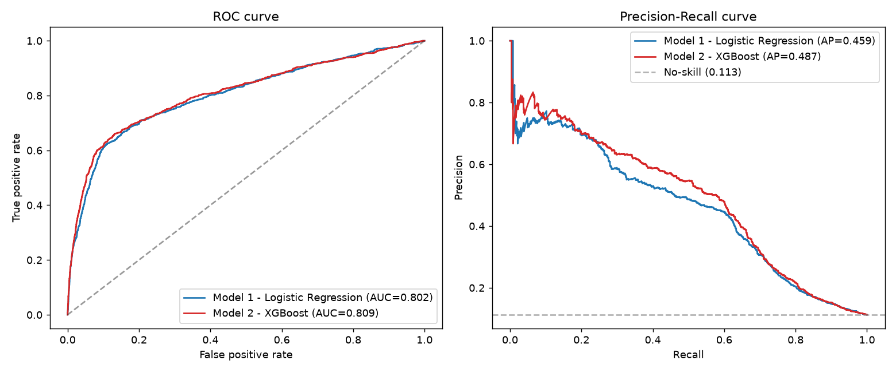

# Comparison of Model 1 and Model 2 (CAP182 SS2 - Part C)

**Related scripts:** scripts/compare_models.py and scripts/explain_models.py

## How to run

~~~bash
python scripts/train_model1_logreg.py
python scripts/train_model2_xgboost.py
python scripts/explain_models.py
python scripts/compare_models.py
~~~

Both models employ the same stratified train/validate split, seed, engineered
features, and hold out rows. Predictions from both models are thus paired and can be
evaluated against each other.

## Metrics side by side

| Metric | Model 1: Logistic Regression | Model 2: XGBoost | Difference (M2 - M1) |
|---|---:|---:|---:|
| Accuracy | 0.8339 | 0.8496 | +0.0157 |
| Balanced accuracy | 0.7536 | 0.7614 | +0.0079 |
| Precision | 0.3663 | 0.3972 | +0.0309 |
| Recall | 0.6498 | 0.6476 | -0.0022 |
| Specificity | 0.8573 | 0.8752 | +0.0179 |
| F1 | 0.4685 | 0.4924 | +0.0239 |
| ROC-AUC | 0.8020 | 0.8090 | +0.0070 |
| PR-AUC | 0.4591 | 0.4868 | +0.0277 |

By applying the 0.50 cutoff, XGBoost eliminates 131 false positives (912 versus
1,043), but loses just two true positives (601 versus 603). Thus, XGBoost retains
meaningful coverage while making the positive predictions more efficient. PR-AUC is an
especially important metric due to the fact that the positive class represents just 11.3%
of the validation set.

## Paired statistical comparison

McNemar’s test looks only at those samples where both models have disagreed:

- model 1 right and model 2 wrong (b): 214
- model 1 wrong and model 2 right (c): 343
- chi-square with continuity correction: 29.415
- chi-square p-value: 5.84 × 10−8
- exact binomial p-value: 5.12 × 10−8

Since the p-value is extremely low and c is greater than b, it can be concluded that
the XGBoost model is significantly more often right about the conflicting samples. 
While statistical significance alone does not imply anything about business value,
in this particular case, it confirms what has been observed.

## ROC and precision-recall curves

The graphs show that there is an average ROC enhancement and a better precision-recall 
gain for XGBoost. Since the ROC graph may be biased by class imbalance, the precision-recall 
chart and the random baseline are more significant.

## Trade-off and verdict

When simplicity, directionality of coefficients and governance are
paramount, Logistic Regression still holds its ground. XGBoost is not as
interpretable, yet it exhibits greater accuracy, balanced accuracy,
precision, specificity, F1, ROC-AUC and PR-AUC, while recall being almost
the same. In addition, the paired t-test proves that the model's
superiority is hardly due to the sampling variance.

**Therefore, XGBoost (Model 2) is recommended to prove the feasibility of
the system in the public dataset setting.** Before deployment, the model's
threshold will need to be chosen depending on outreach and cost of errors,
and calibration as well as validation using temporally different STADIOEquities
data will be required.

